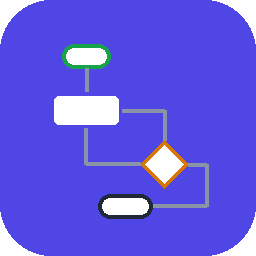
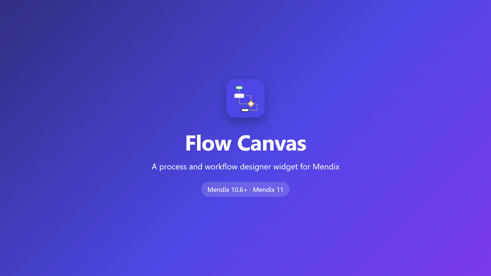
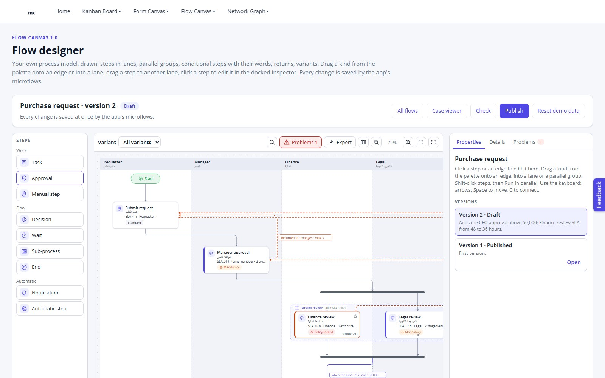
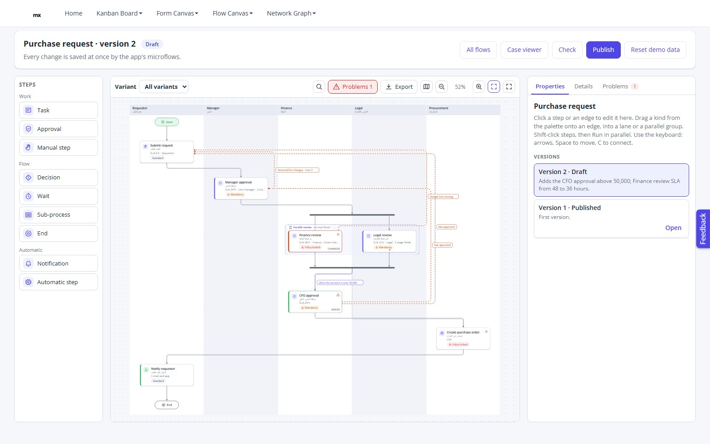
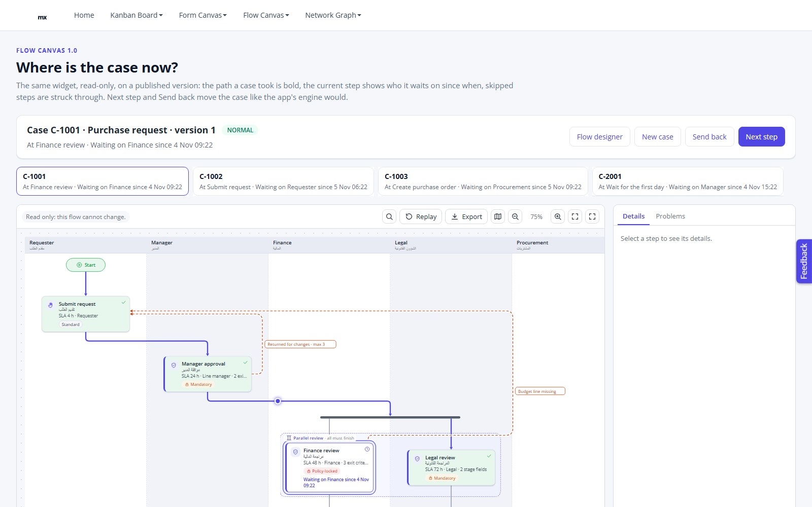
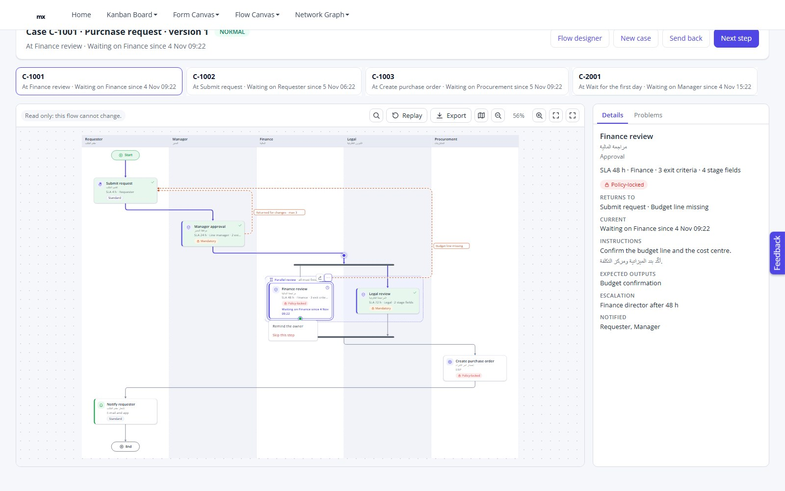
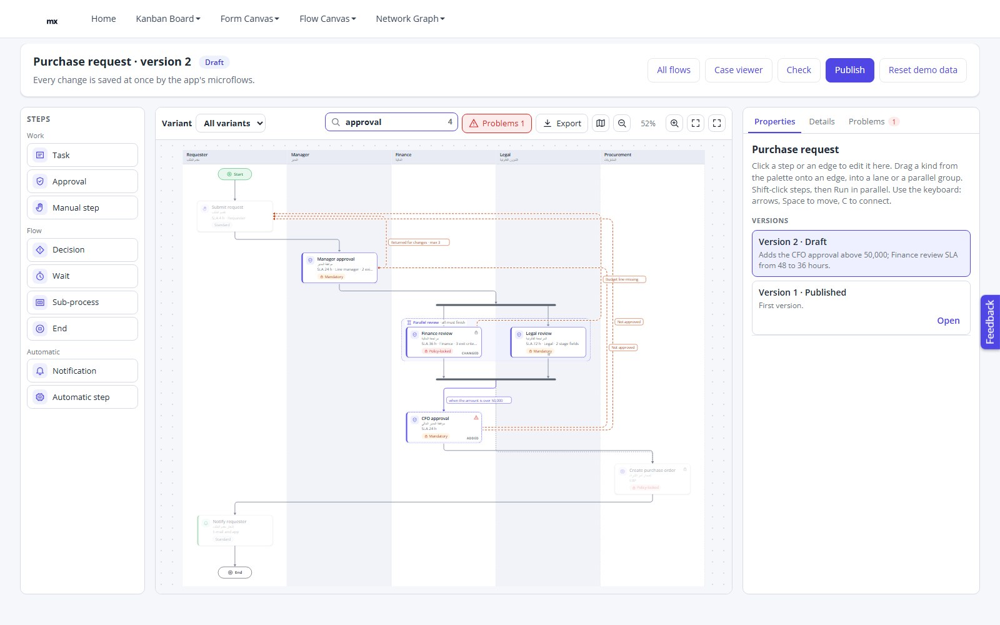
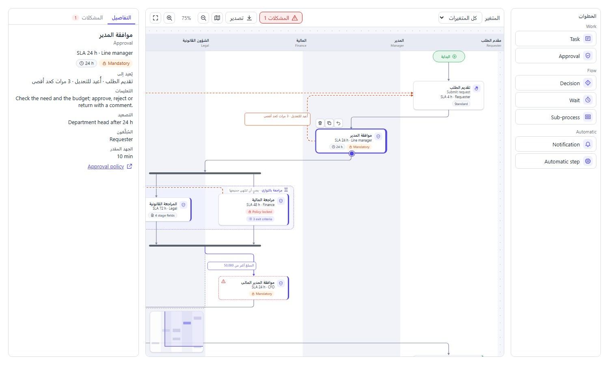
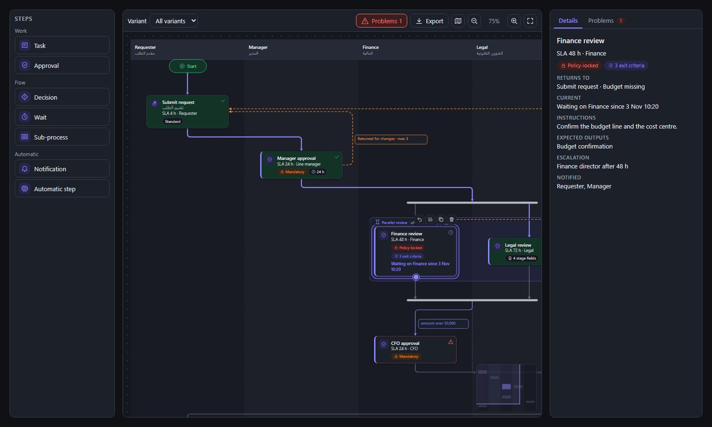
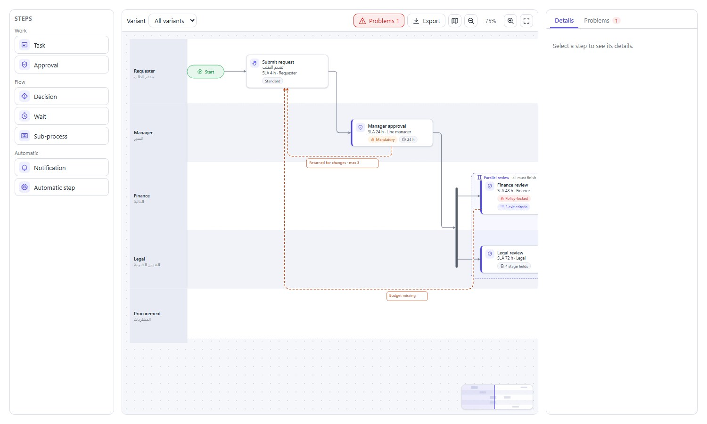

<p align="center"></p>

# Flow Canvas — process and workflow designer for Mendix

A canvas for the processes your app keeps in its own entities: approval chains, onboarding, case handling, stage
gates. Flow Canvas draws the steps in swimlanes with parallel groups, conditions, returns and exceptions, lays them
out by itself, and turns every gesture — add from the palette, drop on an edge, move, connect, send back, run in
parallel — into **your** microflow or nanoflow. The same widget shows a running case: where it is, the path it took,
who it waits on. The widget stores nothing and decides nothing: your app owns the data, the rules, the versions and
the engine.

## Demo video

[](https://youtu.be/7XaXLb315jo)

▶ **[Watch the demo on YouTube](https://youtu.be/7XaXLb315jo)** (1:53, with voice-over and English captions;
[download](video/FlowCanvas-1.0-demo.mp4) · [captions](video/captions_en.srt)) ·
**[Try the demo app](https://aiwidgets-sandbox.mxapps.io/p/flow-designer)**

## Features

- **Swimlanes and a layout of its own** — lanes by role or unit, top to bottom or left to right, compact or roomy;
  parallel groups with fork / join bars and branches of several steps; conditional edges with their words, skip
  paths, returns drawn as curves on the outer side, exceptions and time-outs; start and end markers. Or keep your own
  positions (manual layout, Save layout, Tidy up)
- **Works with the data you have** — no edge table needed: the widget derives the edges from Order, the parallel
  group, the condition and Returns to. An app with an edge entity passes it instead, or both
- **Drag and drop** — palette → into a lane, after a step, into a parallel group, or onto an edge (insert between its
  ends); move a step to another lane; connect two steps; drag back to an earlier step to add a return; run selected
  steps in parallel, ungroup
- **Keyboard first** — arrows follow the flow (mirrored right to left), Space picks a step up and arrows move it (G
  joins or leaves a group), C connects, R sends back, E walks a step's edges, Delete, D duplicates; every change is
  announced with texts you can translate
- **More info for each step** — instructions in two languages, outputs, documents, escalation, who is notified,
  effort, a help link; badges, facts, a problem marker, a change mark (added / changed / removed), a lock
- **Your own step actions** — a step menu (the ⋯ tool, or A) with your actions: Assign, Run now, Escalate, Skip,
  Open the sub-flow… each with a per-step *Visible* expression, offered in the designer, in a viewer or both
- **Move a running case** — drag the current step's handle to another step, or J + arrows + Enter: *On jump* (like
  Mendix's *Jump to activity*), also in a read-only case viewer
- **Find, highlight, full screen, undo / redo** — Ctrl+F outlines matching steps; your *Highlight* keys outline
  steps (impact of a change, your search); a full-screen canvas; Undo / Redo buttons and Ctrl+Z / Ctrl+Y calling
  your actions
- **Done by several people** — a multi-instance marker (at the same time, or one after the other), like a
  multi-user task
- **Runtime** — the current step, the path drawn bold (through returns and skips), a token that travels it, waiting
  since, status per step, a case viewer that is the same widget read-only
- **Variants** — steps and edges that run only in some variants: dimmed or hidden, with a picker
- **Policy as flags** — Locked, Can move, Can delete, Can duplicate per step, Locked per group: the canvas never offers
  what your app would refuse
- **Your side panel** — slots for your inspector, details and a preview; Details and Problems tabs built in; or no
  panel at all
- **Export** — PNG and SVG, with your file name
- **Right to left, dark mode, any language** — flow coordinates mirror the whole canvas, `--flc-*` theme tokens with
  dark defaults, every text a translatable text template (English and Arabic shipped)
- **Works from Mendix 10.6** — no action variables, so it also works inside snippets
- **Studio Pro** — grouped properties that hide what a choice makes unused, consistency checks that name the attribute
  an action needs, structure and design mode previews

## Mendix version compatibility

| Widget version | Mendix version | Tested on |
|---|---|---|
| 1.0.0 | 10.6.0 and later (10.x, 11.x) | 10.24.10 (full demo, 21 browser checks); 11.15.0 (the demo app converted: 21 browser checks, smoke 6); 10.6.11 (smoke module: every data source, action and context attribute, Integer attributes on the Decimal expressions, 6 browser checks) |

## How it works in one picture

```
 your entities ──► Steps data source ──┐
                   Lanes, Groups ──────┤
                   Edges (optional) ───┼─► Flow Canvas ──► gesture ──► writes the drop context ──► calls your action
                   Returns (optional) ─┤     (lays out,                 on the data view object        (microflow / nanoflow)
                   Palette (static/ds) ┘      draws)                    step / target / from / to /    creates, moves, connects,
                                                                        lane / group / kind / position renumbers, commits,
                                                                                                       refuses when it must
```

The canvas shows the change at once and keeps it until your data reloads (or 4 seconds pass), so a refused change
snaps back by itself. A data view that is not editable refuses the gesture before your action runs, and says so.

Flow Canvas is a pluggable web widget (`supportedPlatform="Web"`). The demo module package (`FlowCanvasDemo.mpk`)
needs Studio Pro 10.24.10 or later, because a module package imports only into the version it was made with or a
newer one.

## Installation

### From the Mendix Marketplace
1. In Studio Pro, open the Marketplace and search for **Flow Canvas**.
2. Download it into your app; the widget appears in the toolbox under **Data containers**.

### From GitHub
1. Download `elnady.FlowCanvas.mpk` from the [latest release](https://github.com/MohamedElNady/Flow-Canvas/releases/latest).
2. Copy it into your app's `widgets/` folder.
3. In Studio Pro: **App → Synchronize App Directory**.

### The demo module (optional)
`FlowCanvasDemo.mpk` (a release asset) is the complete demo as a module, with the widget inside it: **File → Import
module package…**, then add `FlowCanvasDemo.Flows_Web` to your navigation. It uses Atlas Core (layout
`Atlas_TopBar`) and Community Commons (`StringSplit`, for the saved layout). Seed it with **Reset demo data** on the
designer. Details in [HOW-TO-TEST.md](HOW-TO-TEST.md).

## Quick start: a viewer in five minutes

1. Drop **Flow Canvas** on a page.
2. **Steps tab** — Steps data source (your step entity, sorted by its order), Key, Title, Order. Add Lane key for
   swimlanes and Group key for steps that run in parallel (the same key, the same order).
3. That is a flow: the widget derives the edges, adds the start and end markers and lays it out.

## Quick start: a designer

1. Create a non-persistent **designer context** entity, e.g. `FlowContext` with `NodeKey`, `TargetKey`, `FromKey`,
   `ToKey`, `EdgeKey`, `LaneKey`, `GroupKey`, `KindKey` (String), `Position` (Integer), `Selection`, `SavedLayout`,
   `SelectedNodeKey`, `SelectedEdgeKey` (String).
2. On your designer page, add a **data view** of that object (a data source microflow that creates it) and drop
   **Flow Canvas** in it.
3. **Actions tab** — select the drop-context attributes, then the actions you support. A step action takes the step
   **and** the context: `ACT_Step_Move($Step, $Context)` reads `$Context/TargetKey`, `$Context/LaneKey`,
   `$Context/GroupKey`, moves the step after the target and renumbers the others. A missing action switches its
   gesture off.

Studio Pro tells you which drop-context attribute an action is missing. See [HOW-TO-CONFIG.md](HOW-TO-CONFIG.md) for
every property and the microflow patterns, [docs/GETTING-STARTED.md](docs/GETTING-STARTED.md) for a first designer
step by step and [docs/BUILD-A-FLOW.md](docs/BUILD-A-FLOW.md) for what people can do on it.

### Placing it with mxcli (MDL) or testing it with scripts

- An expression property's value is itself a quoted string, so a string literal needs doubled inner quotes:
  `edgeSource: '''derived''', flowDirection: '''right''', spacing: '''compact'''`.
- mxcli may write the per-item texts of an optional data source you left unset (Edges, Returns, Groups) as empty
  templates where Studio Pro stores none, which gives CE0463 *"The definition of this widget has changed"*. Set every
  data source, or run *Update widget* after an mxcli write (headless: `mxcli widget sync --widget
  elnady.flowcanvas.FlowCanvas`; `mx update-widgets` works too, but on an MPR v2 app it rewrites the app as one v1
  `.mpr` file).
- A drag needs 4 px of travel before it starts, so a single instant pointer move from a test script does not drag.
  Drive the keyboard (Space, arrows, Enter) or a pointer sequence with a few steps.

## Screenshots

| | |
|---|---|
|  |  |
|  |  |
|  |  |
|  |  |

More in [docs/screenshots](docs/screenshots).

## Limits of 1.0.0

- **A return label per step**: Returns to with several keys shares the step's Return label; give each return its own
  words with the Returns data source (a label per row).
- **Undo / redo are your app's**: the widget offers the buttons and keys; your actions keep the history.
- **No text annotations on the canvas**: put notes in the details card (More details) or in a badge.
- **Join rules are words**: All / Any / N of M are drawn as the group's Join words; your app evaluates them.
- **No nested parallel groups**: a branch can be a sequence (Branch key), not another parallel group.
- **One level of lanes**: no pools or sub-lanes.
- **Change marks, not a side-by-side compare**: added / changed / removed against the version your app compares with.
- **Labelled multi-exit decisions need edges of their own**: derived edges put a condition on a step's incoming
  edge; a gateway with several labelled exits needs the Edges data source (or Edges from `'both'`).
- **A return from a parallel step with a sibling beside it in another lane crosses the sibling's edge** (drawn with a
  gap). In one lane the returning step is placed on the outer side and crosses nothing.

Planned for 1.1: a label per Returns to key, join rules beyond words (N of M progress), nested parallel groups, pools
and sub-lanes, a side-by-side compare of two versions, derived gateways with several labelled exits, and a
crossing-free route for returns across lanes.

## Demo

The demo module (`FlowCanvasDemo.mpk`, in this repository and on the release page; online at
<https://aiwidgets-sandbox.mxapps.io/p/flow-designer>) builds a process designer around the widget: three flows kept three ways (a
purchase request as ordered steps with derived edges, an onboarding and an incident flow with edges of their own),
lanes, a parallel review, a conditional CFO step, variants, draft and published versions with a Publish check, a
docked inspector, a case viewer with Next step and Send back, and step kinds kept as data. See
[HOW-TO-TEST.md](HOW-TO-TEST.md).

## Theming

Every colour is a `--flc-*` custom property set on `.flc`. Override them in your theme:

```scss
.my-dark-mode .flc {
    --flc-surface: #1c2029;
    --flc-canvas: #14171e;
    --flc-text: #e6e9ee;
    --flc-accent: #8b85ff;
}
```

`.dark`, `.theme-dark` and `[data-theme="dark"]` ancestors switch to the built-in dark tokens; *Colour scheme =
Follow system* uses the device setting.

## Accessibility

WCAG 2.1 AA minded: the canvas is one keyboard stop with arrow-key navigation along the flow and a visible focus ring;
every step has an accessible name and a description (kind, lane, status, condition, lock, change, waiting, problem);
moves, connections, returns and edits are announced in a live region; animations stop for users who prefer reduced
motion; status is never shown by colour alone.

## License

Apache-2.0 — © 2026 Mohamed ElNady. Third-party notices: [THIRD-PARTY-NOTICES.md](THIRD-PARTY-NOTICES.md).
